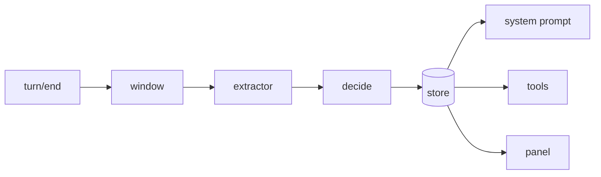

<p align="center"></p>

# dsh-memvault

<p align="center">
  <strong>Long-term memory for DeepSeek Harness.</strong><br>
  blocks in the prompt · turns extracted into one SQLite file · two tools · one panel
</p>

<p align="center">
  <strong>English</strong> | <a href="README.zh.md">中文</a>
</p>

<p align="center">
  
  
  
  
  
</p>

---

MCP is pull-only, so "memory is already loaded" can never come from a server. This plugin does it inside DSH — and since 0.9.x it owns the store too: no Python, no second process.

| Half | What | How |
|---|---|---|
| **Inject** | core blocks in the system prompt, every step | `ctx.systemPrompt.context()` |
| **Extract** | finished turns → one window → one LLM pass | `session/event` → window → `add`/`supersede`/`none` |
| **Recall** | `memory_search` / `memory_add` | FTS5 trigram + vectors, RRF, answerability guard |
| **Show** | overview / memories / structure, block editing, replay | host routes + conversation tab / settings page |

## ✨ Features

| | |
|---|---|
| 🗄️ **One store** | prompt, extraction, tools and panel read `~/.dsh/memvault/memvault.db` |
| 🧠 **No tool call needed** | blocks ride the runtime context, TTL-cached |
| ⏱️ **Off the critical path** | queued windows, one call per `N` turns / idle / cap |
| 🔎 **Hybrid recall** | substring truth (trigram) + paraphrase (vectors), fused |
| 🛠️ **Two tools** | scoped by `user_id` / `agent_id` / `run_id` |
| 🎛️ **A real panel** | diagnostics, vector backfill, provenance, relation graph |
| 🪶 **Zero deps** | `node:sqlite` + hand-written client bundle |

## 🚀 Install

```powershell
dsh plugin --profile desktop add dsh-memvault
```

Self-owned install links a checkout in the profile's `package.json` (`dsh-memvault: link:…`) plus a junction under `node_modules` — see `docs/DEVLOG.md`. A new bundle needs a **DSH restart**; after editing the client run `npm run build`.

## ⚙️ Configuration

| Field | Default |
|---|---|
| `scopes` | `[{user,lenovo},{agent,claude-code-memory}]` |
| `labels` / `maxChars` / `refreshMs` | `[]` / `4000` / `30000` |
| `extract.everyNTurns` / `idleMs` / `windowTurns` | `3` / `20000` / `8` |
| `extract.minTranscriptChars` / `maxInputChars` | `40` / `6000` |
| `extract.projectDir` / `env` | checkout path / `{}` (where `.env` is read) |
| `panel.writes` | `true` |

`dbPath` and `extract.pythonPath` are accepted but unused. The pipeline reads the usual `.env` keys (`OPENAI_*`, `MEMVAULT_EXTRACTOR=rule|llm`, `MEMVAULT_EMBEDDER=local|openai`, `MEMVAULT_ADJUDICATOR=off`).

## 🗄️ Store & migration

`~/.dsh/memvault/memvault.db` (override `DSH_MEMVAULT_CORE_DB`). From the Python store, once:

```bash
memvault export --from data/memvault.db --out export.json
node scripts/import-core.mjs export.json ~/.dsh/memvault/memvault.db --apply
node scripts/backfill-core.mjs ~/.dsh/memvault/memvault.db --project-dir <checkout> --apply
```

## 🏗️ How it works



## 🧪 Verification

`npm test` (6 smokes + 48 unit). Live: `/memvault/api/status` shows the last five outcomes (`[rule]|[llm] ok added=N`); replay via `POST /memvault/api/replay`; recall via `memory_search`.

## 🧠 Decisions

- **One store, not two** — no "tool saw it, panel didn't".
- **Supersede, never delete** — history keeps the audit.
- **Only user text is extracted** — short windows are skipped (`docs/DEVLOG.md` §35).

## ⚠️ Limits

- Single machine, single store: no sync, no encryption.
- Extraction quality depends on the extractor (rule is deterministic but narrow; LLM depends on the endpoint).

## 📄 License

MIT
