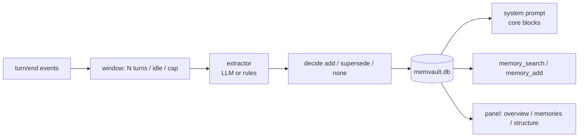

# dsh-memvault

Long-term memory for DeepSeek Harness. One process, one SQLite file, no Python and no services to run.

The plugin does four things:

- **Injects** the core memory blocks of the configured scopes into the system prompt (bounded by `maxChars`, cached for `refreshMs`).
- **Captures** finished turns: every few turns, on idle, or at a window cap, it sends one bounded transcript through an extractor, decides `add` / `supersede` / `none` for each fact, and writes the result.
- **Recalls** through two tools: `memory_search` (FTS5 trigram plus optional vectors, fused with RRF, with an answerability guard) and `memory_add` for facts the extractor would miss.
- **Shows** a panel with three tabs — overview, memories, structure — where core blocks can be edited, missing vectors backfilled, extraction diagnostics read, and a window replayed.

## Requirements

| | |
|---|---|
| DSH | 0.1.x / 0.2.x (peer range in `package.json`) |
| Node | ≥ 22.13 — `node:sqlite` is used without flags. DSH bundles its own Node. |
| Python | **not required** (retired in 0.9.x; see [migration](#store--migration)) |
| Runtime dependencies | none. The three peer packages are provided by DSH. |
| Network | optional: an OpenAI-compatible endpoint for extraction and embeddings. Without one the plugin uses a deterministic rule extractor and offline hashing embeddings. |

## Install

```powershell
dsh plugin --profile desktop add dsh-memvault
```

Or link a checkout (what this repo does on its author's machine):

```jsonc
// ~/.dsh/profiles/<profile>/package.json
{
  "dependencies": { "dsh-memvault": "link:D:/_Projects/skill_mcp/dsh-memvault" },
  "dsh": { "profile": { "bundles": ["…", "dsh-memvault"] } }
}
```

```powershell
New-Item -ItemType Junction `
  -Path "$env:USERPROFILE\.dsh\profiles\desktop\node_modules\dsh-memvault" `
  -Target "D:\_Projects\skill_mcp\dsh-memvault"
```

Restart DSH after adding a bundle (a loaded patch hot-reloads, a new bundle does not). The browser half is committed as `lib/client.js`; after editing `src/client/index.js`, run `npm run build` (the test suite fails on a stale bundle).

> Two known traps: `dsh plugin add` rewrites the profile's `package.json` and can drop other bundles from `dsh.profile.bundles` — re-read the list. pnpm may replace the `link:` junction — recreate it if the plugin stops loading.

## Configuration

One description in `lib/config.js` produces the defaults, the Config schema DSH validates and the panel's view. Values go in `cordis.patch.yml` (a wrong value is reported and the default is used; an undeclared key is reported and ignored).

**Read half**

| Field | Default | Meaning |
|---|---|---|
| `enabled` | `true` | inject the context at all |
| `name` | `memvault:core` | context name in the prompt snapshot |
| `order` | `210` | position among system-prompt contexts |
| `scopes` | `[{user,lenovo},{agent,claude-code-memory}]` | which `(type,id)` pairs to inject |
| `labels` | `[]` | only these block labels (empty = all) |
| `maxChars` | `4000` | budget for the whole rendered string |
| `refreshMs` | `30000` | cache TTL for the block read |
| `panel.writes` | `true` | allow block edits from the panel |

**Write half (`extract.*`)**

| Field | Default | Meaning |
|---|---|---|
| `enabled` | `true` | run extraction at all |
| `everyNTurns` / `idleMs` / `windowTurns` | `3` / `20000` / `8` | flush when either threshold is hit |
| `minTranscriptChars` | `40` | shorter windows are skipped |
| `maxInputChars` | `6000` | transcript budget |
| `includeAssistant` / `includeTools` | `false` / `false` | what goes into the transcript |
| `statePath` | `~/.dsh/storages/dsh-memvault-state.json` | watermarks, diagnostics, retained windows |
| `projectDir` | (checkout path) | where the `.env` is read from |
| `env` | `{}` | overrides on top of the process environment |

**Legacy keys:** `dbPath` and `extract.pythonPath` are still accepted so old configs do not error, but nothing reads them any more. The store is always the in-plugin one.

The pipeline reads the same `.env` the Python engine did, with real environment variables winning: `OPENAI_API_KEY`, `OPENAI_BASE_URL`, `OPENAI_CHAT_MODEL`, `OPENAI_EMBEDDING_MODEL`, `MEMVAULT_EXTRACTOR` (`rule|llm`), `MEMVAULT_EMBEDDER` (`local|openai`), `MEMVAULT_LLM_EXTRA_BODY`, `MEMVAULT_EMBEDDING_DIM`.

## Store & migration

The store lives at `~/.dsh/memvault/memvault.db` (override: `DSH_MEMVAULT_CORE_DB`). Tables: `memories` (with `superseded_by`/`valid_from`), `memory_embeddings` (keyed by model), `blocks`, `relations`, `history` (audit, survives deletion), `flags`, and the FTS5 trigram index `memories_fts`.

Migrating from the old Python MemVault (one time; the old store is then retired):

```bash
memvault export --from data/memvault.db --out export.json          # in the Python checkout
node scripts/import-core.mjs export.json ~/.dsh/memvault/memvault.db --apply
node scripts/backfill-core.mjs ~/.dsh/memvault/memvault.db --project-dir <checkout> --apply
```

Both scripts are dry-run by default and idempotent by memory id. The backfill is the step that restores retrieval quality: imported rows carry text but no vectors.

## How it works



Extraction never blocks a turn: it runs queued, one window at a time, and a failure is recorded in the diagnostics table instead of being retried into the next window.

## Verification

```bash
npm test        # 6 smokes + 48 unit tests
npm run test:core
```

In the running app:

- `/memvault/api/status` reports the store file, the injected blocks, the window state and the last five extraction outcomes (`[rule]|[llm] ok added=N`, `skipped: …`, `failed: …`).
- A replay is the controlled test: `POST /memvault/api/replay` with `{"key":"<retained input>","extractor":"rule","text":"…"}` writes through the real pipeline. The panel's diagnostics link each produced row back to the window that made it.
- `memory_search` is the end-to-end check for recall; `memory_add` for writes.

## Design decisions

- **One store, not two.** The plugin used to read a SQLite file written by a Python service; it now owns the store. Prompt blocks, extraction, the panel and the tools all read the same file, so "the tool found it but the panel did not" cannot happen.
- **Supersede, never delete.** A changed fact points at its replacement; history keeps the audit even when a memory is removed.
- **Hybrid recall with a guard.** FTS5 trigram (Chinese substring search works) plus vectors, fused with RRF; a numeric/time demand without a matching value is rejected instead of guessed.
- **Embeddings are optional and per-model.** Offline hashing by default, an OpenAI-compatible endpoint when `.env` has a key; vectors live in `memory_embeddings` keyed by model, so switching never rewrites memories.
- **Only user text is extracted.** Assistant prose and tool output are excluded by default; short windows are skipped. The trade-off is recorded in `docs/DEVLOG.md` §35.

Full design and history: [`docs/CORE-DESIGN.md`](docs/CORE-DESIGN.md), [`docs/DEVLOG.md`](docs/DEVLOG.md).

## Limits

- Single machine, single store: no sync, no encryption.
- The panel is a viewer plus block editing; it is not a general SQL console.
- Extraction quality depends on the extractor: the rule path is deterministic and narrow, the LLM path needs the endpoint to behave.

## License

MIT
