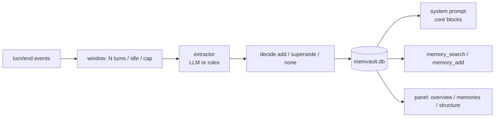

<p align="center"></p>

# dsh-memvault

<p align="center">
  <strong>Long-term memory for DeepSeek Harness — injected on every step, captured from every finished turn,<br>searchable by the model and editable in the GUI.</strong><br>
  one SQLite file · zero runtime dependencies · no Python · no second server
</p>

<p align="center">
  <strong>English</strong> | <a href="README.zh.md">中文</a>
</p>

<p align="center">
  
  
  
  
  
  
  
  
</p>

---

**dsh-memvault** is the client half that memory needs. MCP is a *pull* protocol: a server can be called, but it has no channel to put anything into the model's context — so "memory is already loaded" can never be achieved from the MCP side. This plugin runs inside DSH and does it: core blocks ride the system prompt on **every** step, finished turns flow back as one windowed extraction, and the same store feeds two tools and a panel.

Since 0.9.x the plugin also owns the store: one SQLite file under `~/.dsh/memvault/`, read by prompt injection, extraction, the tools and the panel. The Python MemVault service is no longer involved — it can still use its own database, but this plugin does not.

| Half | What it does | Mechanism |
|---|---|---|
| **Inject** (read) | Core memory blocks enter the system prompt, visible on every step without a tool call | `ctx.systemPrompt.context()` — dynamic runtime context, re-evaluated on `assemble()`, TTL-cached |
| **Extract** (write) | Finished turns accumulate into a window; one extraction pass reads it, decides and writes | `ctx.on('session/event')` → `turn/end` → window → LLM or rule extractor → `add` / `supersede` / `none` |
| **Recall** (tools) | `memory_search` and `memory_add`, share the same store as everything else | FTS5 trigram + optional vectors, fused with RRF, with an answerability guard |
| **Show** (panel) | What is injected, what is stored, how it is shaped — plus block editing and replay | host routes `/memvault/api/*` + a browser half (conversation tab and Settings → Plugins) |

## ✨ Features

| | |
|---|---|
| 🧠 **Injection without tool calls** | Core blocks land in a dynamic runtime context, re-read on the cache TTL — the model simply *has* them |
| 🗄️ **One store, one process** | Prompt, extraction, tools and panel all read `~/.dsh/memvault/memvault.db`; "the tool found it but the panel did not" cannot happen |
| 🧩 **Turn-boundary slicing** | The window is cut from the plugin's own bounded event log at `turn/end`: idempotent, restart-proof, no watermark arithmetic to go stale |
| ⏱️ **Cost-aware extraction** | `everyNTurns` decides when it is worth considering, `idleMs` waits for a pause, `windowTurns` caps it, `minTranscriptChars` skips trivia |
| 🌙 **Background, not on the critical path** | Extraction runs when the session goes quiet, one call per window instead of one call per turn |
| 💾 **Restart-safe window** | The waiting window is persisted on every turn; pending work is extracted on mount and marked as recovered |
| 🎭 **Role filtering** | Assistant prose and tool traffic are excluded by default — shipping them stored the model's own words as facts about the user |
| 🔎 **Hybrid recall** | FTS5 trigram (Chinese substring search works) plus vectors, fused with RRF; a numeric/time demand without a matching value is rejected instead of guessed |
| 🛠️ **Two tools, one store** | `memory_search` for retrieval, `memory_add` for the facts extraction would miss — both scoped by `user_id` / `agent_id` / `run_id` |
| 🎛️ **A real panel** | 概览 / 记忆 / 结构: blocks currently injected, extraction diagnostics, vector backfill, substring browse, provenance and the relation graph |
| ✏️ **Editable core blocks** | 编辑 / 删除 plus a create form; a write is an upsert keyed by `(scope_type, scope_id, label)` and drops the render cache; `panel.writes: false` makes it read-only |
| 🪶 **Zero runtime dependencies** | Plain ESM over the plugin protocol: `node:sqlite`, `node:fs`, `fetch`. The browser half is hand-written against the ModuleLoader envelope — no bundler |
| 🧭 **Fail-soft and observable** | An unreadable store serves the last good text and warns once; a failed extraction is recorded as `[rule]|[llm] failed: …` and never poisons the next window |

## 🧭 Compatibility

| Question | Answer |
|---|---|
| **DSH Desktop** | ✅ Verified live on **0.2.1-rc.5** with the `desktop` profile: the bundle loads, the plugin row is `active`, `/memvault/api/status` answers 200, the injected blocks show up in the runtime context |
| **DSH versions** | Supports the 0.1.x and 0.2.x lines, including 0.2.1 prereleases (`engines.dsh` + both peer ranges) |
| **Do I need a client half?** | Only for the panel. The memory bridge is host-side; disabling the client half costs visibility, never injection |
| **Headless / Web / SDK profiles** | ✅ `systemPrompt` is the only required service; a composition without `webServer` injects memory and simply never registers routes |
| **Is the panel visible?** | ✅ Two seats: a **记忆** tab in the conversation ring, and a **MemVault 记忆桥** page under Settings → Plugins |
| **Windows / macOS / Linux** | ✅ No native build, no Python. Windows works as-is; on other platforms set `projectDir` (where `.env` lives) in the plugin config |
| **Node** | `>= 22.13` for flag-free `node:sqlite`. DSH ships its own Node, so this is only the API floor |
| **Other harnesses (Claude Code, Codex, …)** | ❌ Not this plugin — it is written against the cordis/DSH surface (`ctx.systemPrompt.context`, `session/event`) |

## 🚀 Quick start

Install from npm:

```powershell
dsh plugin --profile desktop add dsh-memvault
```

Or link a checkout (what this repo does on its author's machine):

```jsonc
// ~/.dsh/profiles/<profile>/package.json
{
  "dependencies": { "dsh-memvault": "link:D:/_Projects/skill_mcp/dsh-memvault" },
  "dsh": { "profile": { "bundles": ["…", "dsh-memvault"] } }
}
```

```powershell
New-Item -ItemType Junction `
  -Path "$env:USERPROFILE\.dsh\profiles\desktop\node_modules\dsh-memvault" `
  -Target "D:\_Projects\skill_mcp\dsh-memvault"
```

**Restart DSH after adding a bundle** — a loaded patch hot-reloads, a newly added bundle does not. The browser half is committed as `lib/client.js`; after editing `src/client/index.js` run `npm run build` (a stale bundle fails the test suite).

> Two known traps: `dsh plugin add` rewrites the profile's `package.json` and can drop other bundles from `dsh.profile.bundles` — re-read the list. pnpm can replace the `link:` junction — recreate it if the plugin stops loading.

## ⚙️ Configuration

One description in `lib/config.js` produces the code defaults, the schema DSH validates and the panel's view. Values go in `cordis.patch.yml`: a wrong type is reported and the default is used; an undeclared key is reported and ignored.

**Read half**

| Field | Default | Meaning |
|---|---|---|
| `enabled` | `true` | inject the context at all |
| `name` / `order` | `memvault:core` / `210` | context name and position |
| `scopes` | `[{user,lenovo},{agent,claude-code-memory}]` | which `(type,id)` pairs to inject |
| `labels` | `[]` | only these block labels (empty = all) |
| `maxChars` / `refreshMs` | `4000` / `30000` | render budget and cache TTL |
| `panel.writes` | `true` | allow block edits from the panel |

**Write half (`extract.*`)**

| Field | Default | Meaning |
|---|---|---|
| `enabled` | `true` | run extraction at all |
| `everyNTurns` / `idleMs` / `windowTurns` | `3` / `20000` / `8` | flush when either threshold is hit |
| `minTranscriptChars` / `maxInputChars` | `40` / `6000` | skip short windows, bound the transcript |
| `includeAssistant` / `includeTools` | `false` / `false` | what goes into the transcript |
| `statePath` | `~/.dsh/storages/dsh-memvault-state.json` | watermarks, diagnostics, retained windows |
| `projectDir` / `env` | checkout path / `{}` | where `.env` is read; environment overrides |

**Legacy keys:** `dbPath` and `extract.pythonPath` are still accepted so old configs do not error, but nothing reads them — the store is always the in-plugin one.

The pipeline reads the same `.env` the Python engine did, with real environment variables winning: `OPENAI_API_KEY`, `OPENAI_BASE_URL`, `OPENAI_CHAT_MODEL`, `OPENAI_EMBEDDING_MODEL`, `MEMVAULT_EXTRACTOR` (`rule|llm`), `MEMVAULT_EMBEDDER` (`local|openai`), `MEMVAULT_LLM_EXTRA_BODY`, `MEMVAULT_EMBEDDING_DIM`.

## 🗄️ Store & migration

The store lives at `~/.dsh/memvault/memvault.db` (override: `DSH_MEMVAULT_CORE_DB`). Tables: `memories` (with `superseded_by` / `valid_from`), `memory_embeddings` (keyed by model), `blocks`, `relations`, `history` (audit, survives deletion), `flags`, and the FTS5 trigram index `memories_fts`.

Migrating from the old Python MemVault (one time; the old store is then retired):

```bash
memvault export --from data/memvault.db --out export.json          # in the Python checkout
node scripts/import-core.mjs export.json ~/.dsh/memvault/memvault.db --apply
node scripts/backfill-core.mjs ~/.dsh/memvault/memvault.db --project-dir <checkout> --apply
```

Both scripts are dry-run by default and idempotent by memory id. The backfill is the step that restores retrieval quality: imported rows carry text but no vectors.

## 🏗️ How it works



Extraction never blocks a turn: it runs queued, one window at a time, and a failure is recorded in the diagnostics table instead of being retried into the next window.

## 🧪 Verification

```bash
npm test        # 6 smokes + 48 unit tests
npm run test:core
```

In the running app:

- `/memvault/api/status` reports the store, the injected blocks, the window state and the last five outcomes (`[rule]|[llm] ok added=N`, `skipped: …`, `failed: …`).
- A replay is the controlled test: `POST /memvault/api/replay` with `{"key":"<retained input>","extractor":"rule","text":"…"}` writes through the real pipeline; the panel links each produced row back to its window.
- `memory_search` is the end-to-end check for recall, `memory_add` for writes.

## 🧠 Design decisions

- **One store, not two.** The plugin used to read a SQLite file written by a Python service; it now owns the store, so prompt blocks, extraction, the panel and the tools cannot disagree.
- **Supersede, never delete.** A changed fact points at its replacement; history keeps the audit even when a memory is removed.
- **Hybrid recall with a guard.** Trigram FTS for substring truth, vectors for paraphrase, RRF to fuse them; unanswerable numeric questions are rejected rather than guessed.
- **Embeddings are optional and per-model.** Offline hashing by default; an OpenAI-compatible endpoint when `.env` has a key. Vectors are stored per model, so switching never rewrites memories.
- **Only user text is extracted.** Assistant prose and tool output are excluded by default and short windows are skipped; the trade-off is recorded in `docs/DEVLOG.md` §35.

Full design and history: [`docs/CORE-DESIGN.md`](docs/CORE-DESIGN.md) · [`docs/DEVLOG.md`](docs/DEVLOG.md).

## ⚠️ Known limits

- Single machine, single store: no sync, no encryption.
- The panel is a viewer plus block editing, not a general SQL console.
- Extraction quality depends on the extractor: the rule path is deterministic and narrow; the LLM path depends on the endpoint behaving.

## 📄 License

MIT
