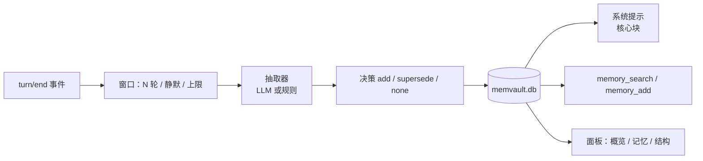

<p align="center"></p>

# dsh-memvault

<p align="center">
  <strong>给 DeepSeek Harness 的长期记忆——每一步都注入、每个回合都回收，<br>模型能检索、界面上能改。</strong><br>
  一个 SQLite 文件 · 零运行时依赖 · 不需要 Python · 不需要第二个服务
</p>

<p align="center">
  <a href="README.md">English</a> | <strong>中文</strong>
</p>

<p align="center">
  
  
  
  
  
  
  
  
</p>

---

**dsh-memvault** 是记忆系统缺的那一半客户端。MCP 是**拉取**协议：服务端可以被调用，但它没有任何通道把内容塞进模型的上下文——所以「记忆已经加载好了」永远不可能从 MCP 那侧实现。这个插件跑在 DSH 内部：核心记忆块随**每一步**进入系统提示，结束的回合以窗口为单位回流，同一个库同时供给两个工具和一个面板。

从 0.9.x 起插件也自己拥有这个库：`~/.dsh/memvault/` 下的一个 SQLite 文件，注入、抽取、工具、面板读的是同一份。Python 的 MemVault 服务不再参与——它可以继续用自己的库，但这个插件不读它。

| 半边 | 做什么 | 机制 |
|---|---|---|
| **注入**（读） | 核心记忆块进入系统提示，每一步都在，不需要模型调工具 | `ctx.systemPrompt.context()`——动态运行时上下文，`assemble()` 时重估，按 TTL 缓存 |
| **抽取**（写） | 结束的回合攒成窗口，一次抽取读完，判完再写 | `ctx.on('session/event')` → `turn/end` → 窗口 → LLM 或规则抽取器 → `add` / `supersede` / `none` |
| **召回**（工具） | `memory_search` 与 `memory_add`，和其他部分共用同一个库 | FTS5 trigram + 可选向量，RRF 融合，带可答性守卫 |
| **查看**（面板） | 注入了什么、存了什么、结构长什么样——外加改块与重放 | 宿主路由 `/memvault/api/*` + 浏览器半边（会话页签与 设置 → 插件） |

## ✨ 特性

| | |
|---|---|
| 🧠 **不用调工具的注入** | 核心块进动态运行时上下文，按缓存 TTL 重读——模型**本来就有** |
| 🗄️ **一个进程一个库** | 提示、抽取、工具、面板都读 `~/.dsh/memvault/memvault.db`，「工具能看到、面板看不到」不可能发生 |
| 🧩 **按回合边界切窗口** | 窗口从插件自己的有界事件日志按 `turn/end` 切：幂等、抗重启、没有会过期的水位算术 |
| ⏱️ **算成本的抽取** | `everyNTurns` 决定何时值得考虑，`idleMs` 等停顿，`windowTurns` 封顶，`minTranscriptChars` 跳过琐碎内容 |
| 🌙 **后台执行，不堵对话** | 会话安静时才抽取，一个窗口一次调用，而不是每回合一次 |
| 💾 **抗重启的窗口** | 待抽取窗口每回合落盘；挂载时把遗留窗口抽掉并标记为 recovered |
| 🎭 **按角色过滤** | 助手散文与工具流量默认不进转写——否则模型自己的话会被当成「用户的事实」存下来 |
| 🔎 **混合召回** | FTS5 trigram（中文子串可用）加向量，RRF 融合；带数字/时间要求却没有对应值时明确拒绝，而不是猜 |
| 🛠️ **两个工具，同一个库** | `memory_search` 负责检索，`memory_add` 补抽取漏掉的事实，都按 `user_id` / `agent_id` / `run_id` 限定范围 |
| 🎛️ **一个真面板** | 概览 / 记忆 / 结构：当前注入的块、抽取诊断、向量回填、子串浏览、出处与关系图 |
| ✏️ **可编辑的核心块** | 编辑 / 删除 + 新建；写入是按 `(scope_type, scope_id, label)` 的 upsert 并清缓存；`panel.writes: false` 变只读 |
| 🪶 **零运行时依赖** | 纯 ESM 跑在插件协议上：`node:sqlite`、`node:fs`、`fetch`。浏览器半边手写 ModuleLoader 封装——没有打包器 |
| 🧭 **失败降级、可观测** | 库读不了就用上次的好文本并只警告一次；抽取失败记成 `[rule]|[llm] failed: …`，不会污染下一个窗口 |

## 🧭 兼容性

| 问题 | 答案 |
|---|---|
| **DSH Desktop** | ✅ 在 **0.2.1-rc.5** 上真机验证过（`desktop` profile）：bundle 加载、插件行 `active`、`/memvault/api/status` 返回 200、注入的块出现在运行时上下文里 |
| **DSH 版本** | 支持 0.1.x 与 0.2.x，包括 0.2.1 预发布（`engines.dsh` 与两个 peer 范围） |
| **需要浏览器半边吗** | 只有面板需要。记忆桥本身全在宿主侧，关掉客户端只损失可见性，不损失注入 |
| **Headless / Web / SDK profile** | ✅ `systemPrompt` 是唯一必需的服务；没有 `webServer` 的组合照样注入，只是不注册路由 |
| **面板在哪** | ✅ 两个位置：会话环里的 **记忆** 页签，以及 设置 → 插件 里的 **MemVault 记忆桥** |
| **Windows / macOS / Linux** | ✅ 无原生编译、无 Python。Windows 开箱可用；其他平台把 `projectDir`（`.env` 所在）配到插件配置里即可 |
| **Node** | `>= 22.13`（免 flag 的 `node:sqlite`）。DSH 自带 Node，这只是 API 下限 |
| **其他 harness（Claude Code、Codex…）** | ❌ 不是这个插件——它写的是 cordis/DSH 表面（`ctx.systemPrompt.context`、`session/event`） |

## 🚀 快速开始

从 npm 安装：

```powershell
dsh plugin --profile desktop add dsh-memvault
```

或链接本地仓库（本机就是这种方式）：

```jsonc
// ~/.dsh/profiles/<profile>/package.json
{
  "dependencies": { "dsh-memvault": "link:D:/_Projects/skill_mcp/dsh-memvault" },
  "dsh": { "profile": { "bundles": ["…", "dsh-memvault"] } }
}
```

```powershell
New-Item -ItemType Junction `
  -Path "$env:USERPROFILE\.dsh\profiles\desktop\node_modules\dsh-memvault" `
  -Target "D:\_Projects\skill_mcp\dsh-memvault"
```

**新增 bundle 后要重启 DSH**——已加载的 patch 会热更新，新 bundle 不会。浏览器半边已提交为 `lib/client.js`；改过 `src/client/index.js` 后跑 `npm run build`（bundle 过期会让测试失败）。

> 两个已知坑：`dsh plugin add` 会重写 profile 的 `package.json`，可能把别的插件从 `dsh.profile.bundles` 里挤掉——改完重新读一遍列表。pnpm 可能替换 `link:` 目录联接，插件突然不加载时先检查它。

## ⚙️ 配置

一处描述（`lib/config.js`）同时生成代码默认值、DSH 校验用的 schema 与面板展示。值写在 `cordis.patch.yml`：类型不对会被报告并退回默认值；未声明的键会被报告并忽略。

**读半边**

| 字段 | 默认值 | 含义 |
|---|---|---|
| `enabled` | `true` | 是否注入 |
| `name` / `order` | `memvault:core` / `210` | 上下文名与位置 |
| `scopes` | `[{user,lenovo},{agent,claude-code-memory}]` | 注入哪些 `(type,id)` |
| `labels` | `[]` | 只注入这些 label（空 = 全部） |
| `maxChars` / `refreshMs` | `4000` / `30000` | 渲染预算与缓存 TTL |
| `panel.writes` | `true` | 允许面板改块 |

**写半边（`extract.*`）**

| 字段 | 默认值 | 含义 |
|---|---|---|
| `enabled` | `true` | 是否抽取 |
| `everyNTurns` / `idleMs` / `windowTurns` | `3` / `20000` / `8` | 任一条件满足就 flush |
| `minTranscriptChars` / `maxInputChars` | `40` / `6000` | 短窗口跳过、转写有界 |
| `includeAssistant` / `includeTools` | `false` / `false` | 转写里放什么 |
| `statePath` | `~/.dsh/storages/dsh-memvault-state.json` | 水位、诊断、保留的窗口 |
| `projectDir` / `env` | 仓库路径 / `{}` | `.env` 从哪里读；环境覆盖 |

**遗留字段**：`dbPath` 与 `extract.pythonPath` 仍被接受（老配置不会报错），但已无人读取——库固定是插件自己的那个。

管线读取的仍是 Python 引擎那份 `.env`，真实环境变量优先：`OPENAI_API_KEY`、`OPENAI_BASE_URL`、`OPENAI_CHAT_MODEL`、`OPENAI_EMBEDDING_MODEL`、`MEMVAULT_EXTRACTOR`（`rule|llm`）、`MEMVAULT_EMBEDDER`（`local|openai`）、`MEMVAULT_LLM_EXTRA_BODY`、`MEMVAULT_EMBEDDING_DIM`。

## 🗄️ 存储与迁移

库在 `~/.dsh/memvault/memvault.db`（可用 `DSH_MEMVAULT_CORE_DB` 覆盖）。表：`memories`（`superseded_by`/`valid_from`）、`memory_embeddings`（按模型存）、`blocks`、`relations`、`history`（审计，删除后仍保留）、`flags`、FTS5 trigram 索引 `memories_fts`。

从旧的 Python MemVault 迁移（一次性，之后旧库退役）：

```bash
memvault export --from data/memvault.db --out export.json          # 在 Python 仓库里
node scripts/import-core.mjs export.json ~/.dsh/memvault/memvault.db --apply
node scripts/backfill-core.mjs ~/.dsh/memvault/memvault.db --project-dir <checkout> --apply
```

两个脚本默认 dry-run，且按记忆 id 幂等。回填那步决定检索质量：导入的行只有文本、没有向量。

## 🏗️ 工作原理



抽取不阻塞对话：排队执行，一次一个窗口；失败会记进诊断表，而不是被带进下一个窗口。

## 🧪 验证

```bash
npm test        # 6 个 smoke + 48 条单测
npm run test:core
```

运行中：

- `/memvault/api/status` 报告库、注入的块、窗口状态与最近五次结果（`[rule]|[llm] ok added=N`、`skipped: …`、`failed: …`）。
- 受控验证用重放：`POST /memvault/api/replay`，body `{"key":"<保留窗口>","extractor":"rule","text":"…"}`，走真实管线写入；面板会把每条产出的记忆链回它的窗口。
- `memory_search` 是召回端的端到端检查，`memory_add` 是写入端。

## 🧠 关键取舍

- **一个库，不是两个。** 以前插件读的是 Python 服务写的 SQLite；现在自己拥有这个库，提示块、抽取、面板、工具不可能互相矛盾。
- **只替代，不删除。** 被改写的事实指向新版本；即使记忆被删，`history` 里的审计仍在。
- **混合召回 + 守卫。** trigram 负责子串事实，向量负责转述，RRF 融合；答不上的数字题明确拒绝而不是猜。
- **向量可选、按模型存。** 默认离线哈希；`.env` 有 key 时用 OpenAI 兼容端点。按模型分行存储，切换不重写记忆。
- **只抽用户文本。** 助手散文与工具输出默认不参与，短窗口直接跳过；这个取舍记在 `docs/DEVLOG.md` §35。

完整设计与历史：[`docs/CORE-DESIGN.md`](docs/CORE-DESIGN.md) · [`docs/DEVLOG.md`](docs/DEVLOG.md)。

## ⚠️ 已知边界

- 单机、单库：无同步、无加密。
- 面板是查看器加块编辑，不是通用 SQL 控制台。
- 抽取质量取决于抽取器：规则路径确定性但窄，LLM 路径依赖端点行为。

## 📄 许可

MIT
