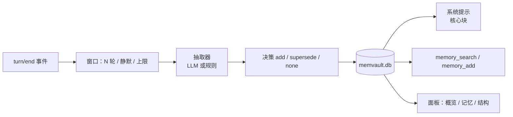

# dsh-memvault

给 DeepSeek Harness 的长期记忆。一个进程、一个 SQLite 文件，不需要 Python，也没有需要常驻的服务。

插件做四件事：

- **注入**：把配置作用域下的核心记忆块渲染进系统提示（受 `maxChars` 约束，`refreshMs` 缓存）。
- **抽取**：每几轮、静默或到达窗口上限时，把一段有界的转写交给抽取器，对每条事实判 `add` / `supersede` / `none` 后写库。
- **召回**：工具 `memory_search`（FTS5 trigram + 可选向量，RRF 融合，带可答性守卫）与 `memory_add`（补抽不到的事实）。
- **查看**：面板三个页签——概览、记忆、结构；可编辑核心块、回填缺失向量、读抽取诊断、重放窗口。

## 运行要求

| | |
|---|---|
| DSH | 0.1.x / 0.2.x（peer 范围见 `package.json`） |
| Node | ≥ 22.13（免 flag 的 `node:sqlite`；DSH 自带 Node） |
| Python | **不需要**（0.9.x 起退役，见[迁移](#存储与迁移)） |
| 运行时依赖 | 无。三个 peer 包由 DSH 提供。 |
| 网络 | 可选：OpenAI 兼容端点用于抽取与向量。没有时自动使用确定性规则抽取器 + 离线哈希向量。 |

## 安装

```powershell
dsh plugin --profile desktop add dsh-memvault
```

或者链接本地仓库（本机就是这种方式）：

```jsonc
// ~/.dsh/profiles/<profile>/package.json
{
  "dependencies": { "dsh-memvault": "link:D:/_Projects/skill_mcp/dsh-memvault" },
  "dsh": { "profile": { "bundles": ["…", "dsh-memvault"] } }
}
```

```powershell
New-Item -ItemType Junction `
  -Path "$env:USERPROFILE\.dsh\profiles\desktop\node_modules\dsh-memvault" `
  -Target "D:\_Projects\skill_mcp\dsh-memvault"
```

新增 bundle 后要重启 DSH（已加载的 patch 会热更新，新 bundle 不会）。浏览器半边已提交为 `lib/client.js`；改过 `src/client/index.js` 后跑 `npm run build`（bundle 过期会让测试失败）。

> 两个已知坑：`dsh plugin add` 会重写 profile 的 `package.json`，可能把别的插件从 `dsh.profile.bundles` 里挤掉——改完重新读一遍列表。pnpm 可能替换 `link:` 目录联接，插件突然不加载时先检查它。

## 配置

一处描述（`lib/config.js`）同时生成默认值、DSH 校验用的 Config schema 与面板展示。值写在 `cordis.patch.yml`：类型不对会被报告并退回默认值，未声明的键也会被报告并忽略。

**读半边**

| 字段 | 默认值 | 含义 |
|---|---|---|
| `enabled` | `true` | 是否注入 |
| `name` | `memvault:core` | 系统提示里的上下文名 |
| `order` | `210` | 在多个上下文中的位置 |
| `scopes` | `[{user,lenovo},{agent,claude-code-memory}]` | 注入哪些 `(type,id)` |
| `labels` | `[]` | 只注入这些 label（空 = 全部） |
| `maxChars` | `4000` | 整段渲染文本的预算 |
| `refreshMs` | `30000` | 块读取的缓存 TTL |
| `panel.writes` | `true` | 允许面板改块 |

**写半边（`extract.*`）**

| 字段 | 默认值 | 含义 |
|---|---|---|
| `enabled` | `true` | 是否抽取 |
| `everyNTurns` / `idleMs` / `windowTurns` | `3` / `20000` / `8` | 任一条件满足就 flush |
| `minTranscriptChars` | `40` | 更短的窗口直接跳过 |
| `maxInputChars` | `6000` | 转写预算 |
| `includeAssistant` / `includeTools` | `false` / `false` | 转写里放什么 |
| `statePath` | `~/.dsh/storages/dsh-memvault-state.json` | 水位、诊断、保留的窗口 |
| `projectDir` | （仓库路径） | 从这里读 `.env` |
| `env` | `{}` | 覆盖进程环境 |

**遗留字段**：`dbPath` 与 `extract.pythonPath` 仍被接受（老配置不会报错），但已无人读取——库固定是插件自己的那个。

管线读取的仍是 Python 引擎那份 `.env`，真实环境变量优先：`OPENAI_API_KEY`、`OPENAI_BASE_URL`、`OPENAI_CHAT_MODEL`、`OPENAI_EMBEDDING_MODEL`、`MEMVAULT_EXTRACTOR`（`rule|llm`）、`MEMVAULT_EMBEDDER`（`local|openai`）、`MEMVAULT_LLM_EXTRA_BODY`、`MEMVAULT_EMBEDDING_DIM`。

## 存储与迁移

库在 `~/.dsh/memvault/memvault.db`（可用 `DSH_MEMVAULT_CORE_DB` 覆盖）。表：`memories`（`superseded_by`/`valid_from` 实现替代）、`memory_embeddings`（按模型存）、`blocks`、`relations`、`history`（审计，删除后仍保留）、`flags`、FTS5 trigram 索引 `memories_fts`。

从旧的 Python MemVault 迁移（一次性，之后旧库退役）：

```bash
memvault export --from data/memvault.db --out export.json          # 在 Python 仓库里
node scripts/import-core.mjs export.json ~/.dsh/memvault/memvault.db --apply
node scripts/backfill-core.mjs ~/.dsh/memvault/memvault.db --project-dir <checkout> --apply
```

两个脚本默认 dry-run，且按记忆 id 幂等。回填那步决定检索质量：导入的行只有文本、没有向量。

## 工作原理



抽取不阻塞对话：排队执行，一次一个窗口；失败会记进诊断表，而不是被带进下一个窗口。

## 验证

```bash
npm test        # 6 个 smoke + 48 条单测
npm run test:core
```

运行中：

- `/memvault/api/status` 报告库文件、注入的块、窗口状态与最近五次抽取结果（`[rule]|[llm] ok added=N`、`skipped: …`、`failed: …`）。
- 受控验证用重放：`POST /memvault/api/replay`，body `{"key":"<保留窗口>","extractor":"rule","text":"…"}`，走真实管线写入。面板诊断会把每条产出的记忆链回它的窗口。
- `memory_search` 是召回端的端到端检查，`memory_add` 是写入端。

## 设计取舍

- **一个库，不是两个。** 以前插件读的是 Python 服务写的 SQLite；现在自己拥有这个库。提示块、抽取、面板、工具读同一份文件，"工具能看到、面板看不到" 不可能发生。
- **只替代，不删除。** 被改写的事实指向新版本；即使记忆被删，`history` 里的审计仍在。
- **混合召回 + 守卫。** FTS5 trigram（中文子串可用）加向量，RRF 融合；带数字/时间要求的提问若候选里没有对应值，明确拒绝而不是猜。
- **向量可选、按模型存。** 默认离线哈希；`.env` 有 key 时用 OpenAI 兼容端点。向量按模型分行，切换不重写记忆。
- **只抽用户文本。** 助手散文与工具输出默认不参与，短窗口直接跳过；这个取舍记在 `docs/DEVLOG.md` §35。

完整设计与历史见 [`docs/CORE-DESIGN.md`](docs/CORE-DESIGN.md)、[`docs/DEVLOG.md`](docs/DEVLOG.md)。

## 已知边界

- 单机、单库：无同步、无加密。
- 面板是查看器加块编辑，不是通用 SQL 控制台。
- 抽取质量取决于抽取器：规则路径确定性但窄，LLM 路径依赖端点行为。

## 许可

MIT
