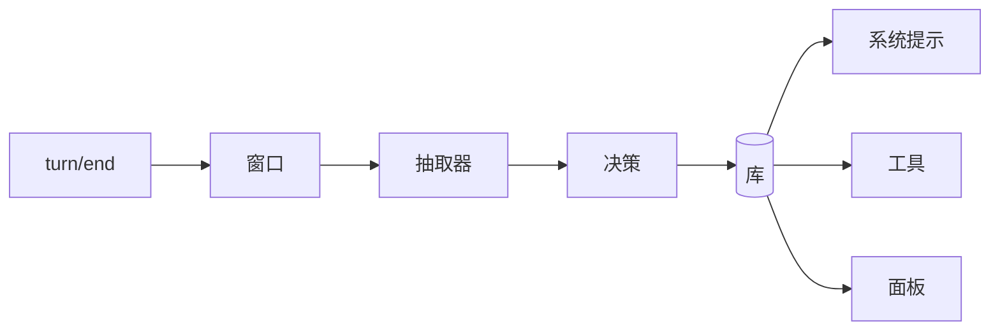

<p align="center"></p>

# dsh-memvault

<p align="center">
  <strong>给 DeepSeek Harness 的长期记忆。</strong><br>
  核心块进提示 · 回合抽进一个 SQLite · 两个工具 · 一个面板
</p>

<p align="center">
  <a href="README.md">English</a> | <strong>中文</strong>
</p>

<p align="center">
  
  
  
  
  
</p>

---

MCP 只能拉不能推，所以「记忆已经加载好」不可能靠服务端实现。这个插件在 DSH 内部做到它——并且从 0.9.x 起自己拥有这个库：没有 Python，没有第二个进程。

| 半边 | 做什么 | 机制 |
|---|---|---|
| **注入** | 核心块进系统提示，每一步都在 | `ctx.systemPrompt.context()` |
| **抽取** | 结束的回合攒成一个窗口，一次 LLM 抽取 | `session/event` → 窗口 → `add`/`supersede`/`none` |
| **召回** | `memory_search` / `memory_add` | FTS5 trigram + 向量，RRF，可答性守卫 |
| **查看** | 概览 / 记忆 / 结构，改块与重放 | 宿主路由 + 会话页签 / 设置页 |

## ✨ 特性

| | |
|---|---|
| 🗄️ **一个库** | 提示、抽取、工具、面板都读 `~/.dsh/memvault/memvault.db` |
| 🧠 **不用调工具** | 块随运行时上下文注入，按 TTL 缓存 |
| ⏱️ **不堵对话** | 窗口排队，每 N 轮 / 静默 / 上限触发一次 |
| 🔎 **混合召回** | 子串（trigram）+ 转述（向量）融合 |
| 🛠️ **两个工具** | 按 `user_id` / `agent_id` / `run_id` 限定 |
| 🎛️ **真面板** | 诊断、向量回填、出处、关系图 |
| 🪶 **零依赖** | `node:sqlite` + 手写客户端 bundle |

## 🚀 安装

```powershell
dsh plugin --profile desktop add dsh-memvault
```

自持安装是在 profile 的 `package.json` 里写 `dsh-memvault: link:…` 加一个 `node_modules` 目录联接（见 `docs/DEVLOG.md`）。新增 bundle 要**重启 DSH**；改过客户端后跑 `npm run build`。

## ⚙️ 配置

| 字段 | 默认值 |
|---|---|
| `scopes` | `[{user,lenovo},{agent,claude-code-memory}]` |
| `labels` / `maxChars` / `refreshMs` | `[]` / `4000` / `30000` |
| `extract.everyNTurns` / `idleMs` / `windowTurns` | `3` / `20000` / `8` |
| `extract.minTranscriptChars` / `maxInputChars` | `40` / `6000` |
| `extract.projectDir` / `env` | 仓库路径 / `{}`（`.env` 从哪读） |
| `panel.writes` | `true` |

`dbPath` 与 `extract.pythonPath` 仍被接受但不再使用。管线读的还是那套 `.env`（`OPENAI_*`、`MEMVAULT_EXTRACTOR=rule|llm`、`MEMVAULT_EMBEDDER=local|openai`、`MEMVAULT_ADJUDICATOR=off`）。

## 🗄️ 存储与迁移

`~/.dsh/memvault/memvault.db`（可用 `DSH_MEMVAULT_CORE_DB` 覆盖）。从 Python 库迁移一次：

```bash
memvault export --from data/memvault.db --out export.json
node scripts/import-core.mjs export.json ~/.dsh/memvault/memvault.db --apply
node scripts/backfill-core.mjs ~/.dsh/memvault/memvault.db --project-dir <checkout> --apply
```

## 🏗️ 工作原理



## 🧪 验证

`npm test`（6 smoke + 48 单测）。运行中：`/memvault/api/status` 看最近五次结果（`[rule]|[llm] ok added=N`）；`POST /memvault/api/replay` 受控重放；`memory_search` 验召回。

## 🧠 取舍

- **一个库，不是两个**——不会出现“工具看到、面板没看到”。
- **只替代，不删除**——审计还在 `history` 里。
- **只抽用户文本**——短窗口直接跳过（`docs/DEVLOG.md` §35）。

## ⚠️ 边界

- 单机、单库：无同步、无加密。
- 抽取质量取决于抽取器（规则确定但窄，LLM 看端点）。

## 📄 许可

MIT
