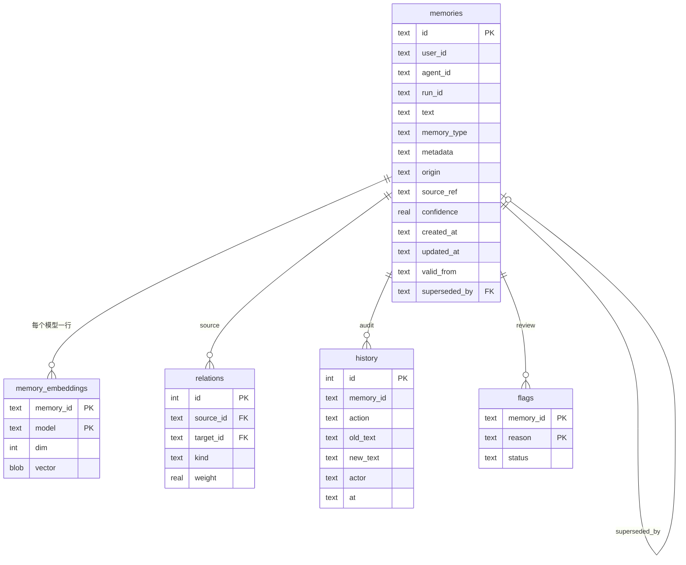
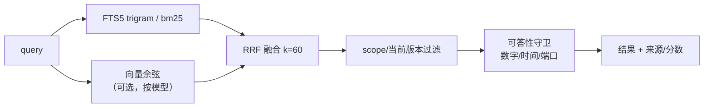

# dsh-memvault 新内核设计（JS core）

> 目标：Python 引擎退役后，插件自带**存储、抽取、检索**三件事，装一个插件即完整功能。
> 旧库 `data/memvault.db` 导出成 JSON 后归档，新库按本文结构重建。
> 状态：**M0–M2 检索 + 工具定义已实现**（`lib/core/`，测试 `test/core*.test.mjs`）；工具接线与面板待做。

## 1. 约束（本机实测，不是假设）

| 事实 | 值 | 来源 |
|---|---|---|
| DSH 运行时 | Electron 44.7.0 / **Node 24.21.0** | `ELECTRON_RUN_AS_NODE=1` 探测 |
| 内置 SQLite | **3.53.4**，`node:sqlite` 可用 | 同上 |
| FTS5 | 可用，含 **trigram** 分词器 | 同上（已建表、插入、MATCH 验证） |
| 部署形态 | 单进程写、多读；库放 `~/.dsh/memvault/memvault.db` | WAL + `busy_timeout` |
| 外部依赖 | 无 Python、无常驻服务；抽取/裁判可选（OpenAI 兼容 HTTP） | — |

结论：FTS5 trigram 可以直接作为关键词层，不需要在 JS 里手写 BM25。

## 2. 数据模型



### 2.1 与旧库的关键差异

| 旧 | 新 | 为什么 |
|---|---|---|
| `embedder`/`embed_dim` 存在行上 | 独立 `memory_embeddings(memory_id, model, dim, vector)` | 换模型不重写行；可同时保留两份向量；旧库的"同维换模型无法证明"问题消失 |
| UPDATE **原地覆盖** | `superseded_by` + `valid_from` | 能回答"当时是什么"；历史不靠 `history` 拼 |
| 无 `origin`/`confidence` | 有 | 导入 vs 抽取得分得清；低置信可进复核 |
| 无全文索引 | `memories_fts`（trigram, bm25） | 中文子串检索；短查询走 LIKE 兜底 |
| 复核标记在插件状态文件 | `flags` 表 | 队列随数据走，导出即带走 |
| 无 schema 版本 | `meta.schema_version` | 迁移有据可依 |

### 2.2 DDL（`node:sqlite` 直接可跑）

```sql
PRAGMA journal_mode = WAL;
PRAGMA foreign_keys = ON;
PRAGMA busy_timeout = 3000;

CREATE TABLE meta (
  key   TEXT PRIMARY KEY,
  value TEXT NOT NULL
) WITHOUT ROWID;

CREATE TABLE memories (
  id            TEXT PRIMARY KEY,
  user_id       TEXT,
  agent_id      TEXT,
  run_id        TEXT,
  text          TEXT NOT NULL,
  memory_type   TEXT NOT NULL DEFAULT 'user'
                CHECK (memory_type IN ('user','agent','procedural')),
  metadata      TEXT NOT NULL DEFAULT '{}',
  origin        TEXT NOT NULL DEFAULT 'manual',   -- extract | manual | import:<source>
  source_ref    TEXT,                              -- session/turn，或导入来源引用
  confidence    REAL NOT NULL DEFAULT 1.0,
  created_at    TEXT NOT NULL,
  updated_at    TEXT NOT NULL,
  valid_from    TEXT NOT NULL,
  superseded_by TEXT REFERENCES memories(id) ON DELETE SET NULL,
  CHECK (user_id IS NOT NULL OR agent_id IS NOT NULL OR run_id IS NOT NULL)
);

CREATE INDEX memories_scope_current
  ON memories(user_id, agent_id, run_id) WHERE superseded_by IS NULL;
CREATE INDEX memories_superseded ON memories(superseded_by);

CREATE TABLE memory_embeddings (
  memory_id  TEXT NOT NULL REFERENCES memories(id) ON DELETE CASCADE,
  model      TEXT NOT NULL,
  dim        INTEGER NOT NULL,
  vector     BLOB NOT NULL,
  created_at TEXT NOT NULL,
  PRIMARY KEY (memory_id, model)
) WITHOUT ROWID;

CREATE VIRTUAL TABLE memories_fts USING fts5(
  text,
  content='memories',
  content_rowid='rowid',
  tokenize='trigram'
);

CREATE TRIGGER memories_ai AFTER INSERT ON memories BEGIN
  INSERT INTO memories_fts(rowid, text) VALUES (new.rowid, new.text);
END;
CREATE TRIGGER memories_ad AFTER DELETE ON memories BEGIN
  INSERT INTO memories_fts(memories_fts, rowid, text) VALUES ('delete', old.rowid, old.text);
END;
CREATE TRIGGER memories_au AFTER UPDATE OF text ON memories BEGIN
  INSERT INTO memories_fts(memories_fts, rowid, text) VALUES ('delete', old.rowid, old.text);
  INSERT INTO memories_fts(rowid, text) VALUES (new.rowid, new.text);
END;

CREATE TABLE blocks (
  scope_type  TEXT NOT NULL CHECK (scope_type IN ('user','agent')),
  scope_id    TEXT NOT NULL,
  label       TEXT NOT NULL,
  value       TEXT NOT NULL,
  value_limit INTEGER NOT NULL DEFAULT 2000,
  position    INTEGER NOT NULL DEFAULT 0,
  created_at  TEXT NOT NULL,
  updated_at  TEXT NOT NULL,
  PRIMARY KEY (scope_type, scope_id, label)
) WITHOUT ROWID;

CREATE TABLE relations (
  id         INTEGER PRIMARY KEY,
  source_id  TEXT NOT NULL REFERENCES memories(id) ON DELETE CASCADE,
  target_id  TEXT NOT NULL REFERENCES memories(id) ON DELETE CASCADE,
  kind       TEXT NOT NULL DEFAULT 'related'
             CHECK (kind IN ('related','similar','contradicts','supersedes')),
  weight     REAL NOT NULL DEFAULT 0,
  created_at TEXT NOT NULL,
  UNIQUE (source_id, target_id, kind)
);

CREATE TABLE history (
  id        INTEGER PRIMARY KEY,
  -- No foreign key on purpose: the audit trail must outlive the memory it is
  -- about, or a delete erases its own record (the real export carries history
  -- rows whose memory was deleted in the old store).
  memory_id TEXT NOT NULL,
  action    TEXT NOT NULL
            CHECK (action IN ('add','update','supersede','delete','import')),
  old_text  TEXT,
  new_text  TEXT,
  actor     TEXT NOT NULL DEFAULT 'system',  -- extractor | manual | import:<source>
  at        TEXT NOT NULL
);
CREATE INDEX history_memory ON history(memory_id, at);

CREATE TABLE flags (
  memory_id  TEXT NOT NULL REFERENCES memories(id) ON DELETE CASCADE,
  reason     TEXT NOT NULL,
  status     TEXT NOT NULL DEFAULT 'open'
             CHECK (status IN ('open','resolved','dismissed')),
  created_at TEXT NOT NULL,
  PRIMARY KEY (memory_id, reason)
) WITHOUT ROWID;
```

## 3. 检索流水线



- **融合用 RRF**，不用加权分数：旧库实测"混合分不可比、0.55 阈值分不开答不答得了"，那次教训直接写进设计。
- **中文短查询**：trigram 要求 ≥3 字符；`端口`、`AI` 这类两字查询退化为 `LIKE '%q%'`（库小，可接受），并在结果里标明"关键词兜底"。
- **默认语义**：JS 移植旧库的 feature-hashing（384 维、离线、零配置）；配了 OpenAI 兼容端点就再加一个 `model` 行，检索时择优/并用。
- **答案校验**沿用 0.9.x：守卫（离线）→ 必要时一次小模型裁判；失败开放。

## 4. 写入流水线


- 决策失败、超时、非法 id 一律**按条回退规则策略**（沿用旧引擎的做法）。
- `update` 写成 **supersede**：旧行 `superseded_by=新 id`，新行 `valid_from=now`；检索默认只看当前。
- 同批事实之间仍写 `relations(kind='similar')`。

## 5. 导入映射（`memvault-export` v1 → 新库）

| 导出字段 | 新位置 | 说明 |
|---|---|---|
| `memories[].id` | `memories.id` | 保留，便于幂等重导 |
| `user_id` / `agent_id` / `run_id` | 同名列 | — |
| `memory` | `text` | — |
| `memory_type` | `memory_type` | 不在枚举内的归 `user` |
| `metadata`（对象） | `metadata`（JSON 字符串） | — |
| `created_at` | `created_at` + **`valid_from`** | 导入即当前版本 |
| `updated_at` | `updated_at` | — |
| — | `origin='import:memvault-export'` | 可追溯 |
| `embedding`（仅 `--with-vectors`） | `memory_embeddings`（model 已知才写） | 否则丢弃，检索时重算 |
| `blocks[]` | `blocks` | 主键一致 |
| `history[].action` | `history.action` 小写 | `ADD→add` 等 |
| `relations[]` | `relations(kind='related', weight)` | 旧库只有"相关"一种 |

主流库（mcp-memory / basic-memory / mem0）走同一套导入器，只是 `origin` 与 `source_ref` 不同；
幂等键是 `id`（外部源没有 id 时用 `sha1(scope + text)`）。

## 6. 里程碑

| 阶段 | 内容 | 验收 |
|---|---|---|
| **M0** | store + schema + 4 个导入器（memvault-export / mcp-memory / basic-memory / mem0） | 导出→导入→条数与内容一致；node:test 全绿 |
| **M1** | 抽取（HTTP）+ 结构化决策 + supersede | 旧库同款用例：改写判 update、冲突判 supersede |
| **M2** | 检索（FTS+向量+RRF+守卫）+ MCP 工具 + 面板读新库 | 评测集上 recall/negative 不劣于旧引擎 |
| **M3** | 退役 Python 路径；迁移文档收尾 | 插件不再 spawn Python |

## 7. 未决（可以再吵一轮）

1. **FTS5 trigram 还是 JS BM25**：我选 trigram（原生、bm25、少写代码），代价是 <3 字符要 LIKE 兜底。
2. **默认语义嵌入**：移植 feature-hashing（离线但弱）／默认关闭纯 FTS（简单但"记忆检索"退化成关键词）／首次启动引导配端点。我倾向移植。
3. **多设备、加密**：明确不做，单机本地库。

## 8. 验证记录（2026-11-01）

这份 DDL 不只是写在纸上：它在 **DSH 运行时**（Electron 44.7.0 / Node 24.21.0 / SQLite 3.53.4）
里实际建库并跑过：

- FTS5 **trigram 命中中文子串**「违规事件」✓
- **UPDATE 触发器**同步 FTS：改词后旧词 0 命中、新词 1 命中 ✓
- **supersede**：`superseded_by` 指向新行后，当前视图只剩新行，旧行仍可按 id 查 ✓
- 两字查询走 `LIKE` 兜底不报错 ✓
